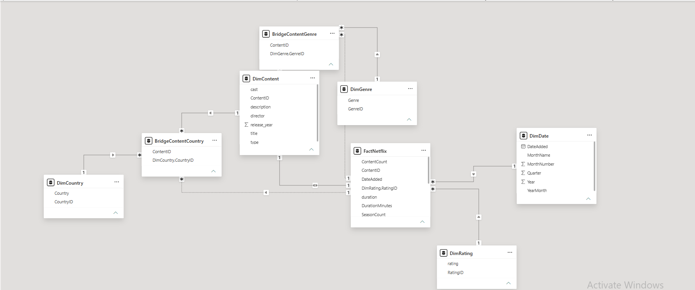
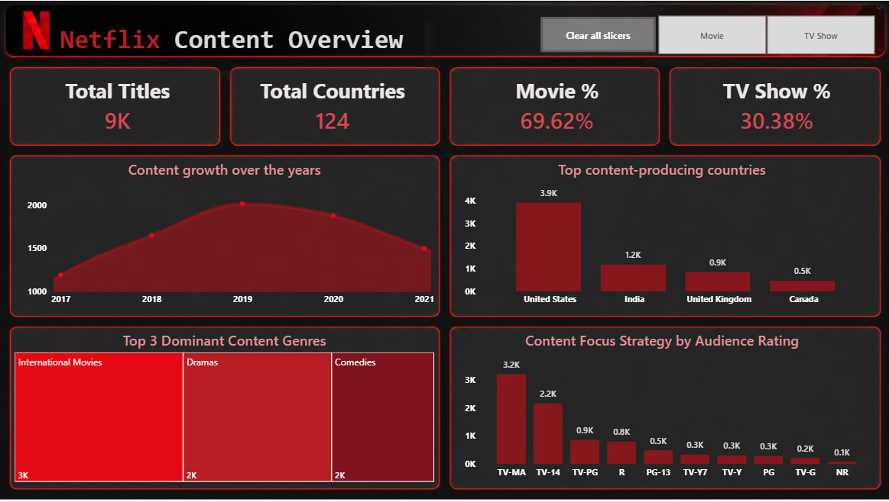
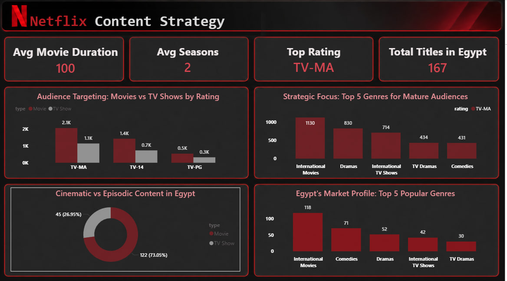

# 🎬 Netflix Data Analysis Dashboard

An interactive **Power BI** dashboard that analyzes Netflix's content library: content types, genres, production countries, and release trends.

---

## 📷 Dashboard Preview





---

## 🎯 Project Objectives

The dashboard answers key questions such as:

- How large is Netflix's content library?
- What is the split between Movies and TV Shows?
- Which countries produce the most Netflix content?
- What are the most common genres?
- How has Netflix's content evolved over the years?

---

## 📈 Key Insights

> Replace these with your real findings.

- Netflix's library contains **[X] titles**, of which **[X]%** are Movies and **[X]%** are TV Shows.
- **[Country]** is the top content producer, followed by **[Country]** and **[Country]**.
- The most common genre is **[Genre]**.
- Content additions peaked in **[Year]**.

---

## 📊 Dashboard Pages

**Netflix Overview**
- KPIs: Total Titles, Total Countries, Movie %, TV Show %
- Content growth over time

**Content Analysis**
- Movies vs TV Shows
- Top genres
- Release trends

**Geographic Analysis**
- Content by country
- Top content-producing countries

---

## 🛠️ Tools & Technologies

Power BI · Power Query · DAX · Microsoft Excel · Star Schema

---

## 🧹 Data Preparation

Data was cleaned and transformed in **Power Query**:

- Handled missing values and removed duplicates
- Cleaned text fields and fixed data types
- Split multi-value columns (countries, genres)
- Created calculated columns needed for analysis

---

## ⭐ Data Modeling

A **Star Schema** was used to improve model structure and performance.

| Type | Table |
|---|---|
| Fact | `FactNetflix` |
| Dimension | `DimDate` |
| Dimension | `DimCountry` |
| Dimension | `DimGenre` |

---

## 📂 Project Structure

```text
Netflix-Data-Analysis-PowerBI/
├── Netflix_Dashboard.pbix
├── Netflix_Dataset.xlsx
├── README.md
└── Screenshots/
    ├── netflix_overview.png
    ├── content_analysis.png
    └── geographic_analysis.png
```

---

## ▶️ How to Open

1. Download `Netflix_Dashboard.pbix`.
2. Open it with **Power BI Desktop** (Windows).
3. If prompted, point the data source to `Netflix_Dataset.xlsx`.

---

## 📦 Dataset

Source: [add the dataset link here, e.g. Kaggle]

---

## 👨‍💻 Author

**Hamdy Osama**
Computer Science Student | Backend Development | Data Analysis | AI

- GitHub: [Hamdy812](https://github.com/Hamdy812)
- LinkedIn: [Hamdy Osama](https://www.linkedin.com/in/hamdy-osama)

---

*Developed as part of my learning journey in Data Analysis, Power BI, and AI.*
